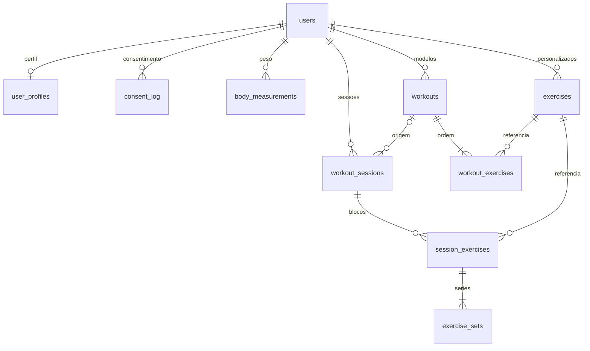

# Gym Easy

Gym Easy (V1). Next.js (App Router) + TypeScript estrito + Tailwind CSS v4 + Drizzle com postgres.js.

## Requisitos

- Node.js 22 ou mais recente
- pnpm 10 (`packageManager` do `package.json`)
- [gitleaks](https://github.com/gitleaks/gitleaks) v8.30.1 no `PATH` (hook de pre-commit)

## Setup local

```bash
pnpm install
cp .env.example .env.local
```

Preencha `DATABASE_URL` em `.env.local`. O destino é o Postgres partilhado do homelab, só na rede interna e com TLS (`sslmode=require`). O Neon, com a mesma forma de URL e `sslmode=require`, fica como fallback. A variável é só de servidor: não use o prefixo `NEXT_PUBLIC_`.

O email de autenticação sai pelo transporte em `EMAIL_TRANSPORT` (`smtp`, `resend` ou `log`). Em `NODE_ENV=production` só `resend` é aceite, com `RESEND_API_KEY` obrigatória: `smtp` e `log` falham no arranque. Fora de produção, `smtp` e `log` são permitidos. O teste (`NODE_ENV=test`) usa `log` quando a variável não está definida. Não há fallback silencioso para `log` se o envio ou a configuração falharem: a UI mostra o erro e o botão de tentar de novo. `log` registra só o tipo (`email.account_confirmation`, `email.account_exists_notice` ou `email.password_reset`), o destinatário redigido (`a***@[redacted]`) e um id. Não registra corpo, token, link de confirmação nem o endereço completo.

Os links absolutos dos emails usam `APP_URL`, não o `Host` do pedido. Em produção o valor é `https://app.gaffer.pt`. No compose local o padrão é `http://127.0.0.1:3000`.

O remetente padrão é `Gym Easy <noreply@gaffer.pt>`. O app não cria conta no Resend. `EMAIL_CAPTURE_PATH` existe só para o e2e. No runtime de produção (`NODE_ENV=production` sem `CI=true`) esse caminho é ignorado. A CI define `CI=true`, então o Playwright continua a ler o capture.

Se o envio falhar (SMTP ou Resend), o cadastro continua: a conta fica criada e o app abre `/cadastro/confirme?fresh=1&delivery=failed` com o aviso "Não conseguimos enviar o email agora. Tente de novo em instantes." O reenvio de confirmação e o pedido em `/esqueci-senha` mostram o mesmo aviso, exista a conta ou não. O cooldown de 60 segundos continua valendo; depois dele dá para tentar de novo.

## Desenvolvimento local

O Coolify serve só produção (`https://app.gaffer.pt`). O desenvolvimento corre nesta máquina, com o compose (app + Mailpit). O banco é o Postgres partilhado do homelab; o Neon fica como fallback.

```bash
docker compose up --build
```

O `Dockerfile` é standalone, na porta 3000, com healthcheck em `GET /api/health`. O compose publica a app só em `127.0.0.1:3000`. O SMTP 1025 e a UI 8025 do Mailpit não têm porta no host e não recebem domínio. A UI do Mailpit não tem autenticação.

Copie `.env.example` para `.env` (o compose interpola esse arquivo, não `.env.local`). Preencha `DATABASE_URL` (homelab interno com `sslmode=require`, ou o Neon de fallback), `CONFIRM_EMAIL_SECRET` e `CONSENT_PSEUDONYM_KEY`. A app fica limitada a `768m` (`mem_limit`). Não grave segredos no repositório. Produção no Coolify usa `EMAIL_TRANSPORT=resend` e não fala com o Mailpit. O Mailpit fica no profile `dev`:

```bash
docker compose --profile dev up --build
```

Nesse profile, `.env` define `EMAIL_TRANSPORT=smtp`, `SMTP_HOST=mailpit`, `SMTP_PORT=1025` e `SMTP_SECURE=false`. SMTP sem TLS só é aceite para `mailpit`, `localhost` ou `127.0.0.1` fora de produção. Qualquer outro host exige TLS (`requireTLS` ou `SMTP_SECURE=true`) e `SMTP_USER`/`SMTP_PASS`. O pool do cliente é o do `postgres.js` (`DB_POOL_MAX`, padrão 5, entre 5 e 10).

```bash
pnpm dev
```

`pnpm dev` no host não resolve o nome `mailpit`. Para falar com o Mailpit, use o compose. `GET /api/health` executa `select 1` e responde `{ "status": "ok", "db": "ok" }`. Se o banco falhar, responde 503 `{ "status": "error", "db": "unavailable" }` sem detalhes do erro. O catálogo visual fica em `/design` e responde 404 quando `NODE_ENV=production`.

`pnpm build` não precisa de um Postgres real. Durante o build, se `DATABASE_URL` estiver ausente, `src/lib/env.ts` usa um placeholder que não abre conexão. Em `pnpm dev` e `pnpm start` a variável continua obrigatória para qualquer código que chame `getDb()`.

## Banco

O schema Drizzle mora em `src/db/schema.ts`. O cliente é `postgres.js` (`drizzle-orm/postgres-js`), com pool de `DB_POOL_MAX` ligações (5 a 10, padrão 5), `idle_timeout` (`DB_IDLE_TIMEOUT`, padrão 20 segundos), `connect_timeout` (`DB_CONNECT_TIMEOUT`, padrão 10 segundos) e `statement_timeout` (`DB_STATEMENT_TIMEOUT`, padrão 15000 milissegundos). O TLS vem de `sslmode` na `DATABASE_URL` (`sslmode=require`). O driver HTTP do Neon não entra no runtime. O Neon continua a funcionar como fallback com a mesma URL.

```bash
pnpm db:generate   # gera SQL em src/db/migrations
pnpm db:migrate    # aplica no DATABASE_URL
```

`pnpm db:migrate` aplica só o SQL pendente. O host não pode ter `-pooler`.

- No pull request, a CI sobe um Postgres 16, corre `pnpm db:migrate` e, em seguida, `scripts/migrate-on-deploy.mjs` com `RUN_MIGRATIONS=true` e `DATABASE_URL_MIGRATOR` nesse mesmo banco.
- Não migre produção a partir de uma branch de feature.
- Em produção o contentor aplica as migrações. Com `RUN_MIGRATIONS=true`, `docker/entrypoint.sh` corre `scripts/migrate-on-deploy.mjs` antes do servidor. O script exige `DATABASE_URL_MIGRATOR` com o utilizador `gym_easy_migrator` (não usa `DATABASE_URL` da app), host direto e `sslmode=require`. Segura um `pg_advisory_lock` para dois contentores não migrarem ao mesmo tempo e só então o entrypoint faz `exec` do servidor. Se a migração falha, o contentor sai com código diferente de 0. O padrão de `RUN_MIGRATIONS` é `false`. O script recusa um host com `-pooler`, outro utilizador, e não imprime a URL nem a mensagem de erro.
- O deploy fica em `.github/workflows/deploy-coolify.yml`. O trigger é `workflow_run` do workflow `CI`, com `conclusion` `success` e branch `main`. O job mantém `concurrency` (`production-deploy`, `cancel-in-progress: false`) e `environment: production`. O step faz `curl` ao secret `COOLIFY_DEPLOY_WEBHOOK` com `Authorization: Bearer` e o secret `COOLIFY_TOKEN`. Não imprime a URL nem o token. O CI de um pull request não faz deploy. As actions do CI continuam pinadas por SHA; este workflow só usa o shell do runner.

Não edite uma migração que já tenha sido aplicada.

## Modelo de dados

A V1 guarda credenciais, perfil, catálogo de exercícios, modelos de treino e o que foi executado. O `user_id` de cada linha vem da sessão. Nenhum schema Zod aceita `userId` no corpo da requisição. As queries de `src/features/training/repository.ts` filtram por esse id e respondem "não encontrado" quando o recurso é de outra pessoa.



| Tabela                                                               | Papel                                                                                                                                                                 |
| -------------------------------------------------------------------- | --------------------------------------------------------------------------------------------------------------------------------------------------------------------- |
| `users`, `sessions`, `email_verification_tokens`, `auth_rate_limits` | Conta e sessão (LED-6).                                                                                                                                               |
| `user_profiles`                                                      | Única tabela de perfil. Ano de nascimento, sexo, altura, objetivo, nível, dias, minutos, local, unidade, tema e descanso. Não existe `user_profile` nem coluna `age`. |
| `consent_log`                                                        | Consentimento append-only (`body_data`, `coach_health`, `analytics`). Revogação é uma linha nova. Depois da exclusão da conta fica só o pseudônimo HMAC.              |
| `body_measurements`                                                  | Histórico de peso. No máximo um registro por usuário e dia; o do mesmo dia substitui o anterior.                                                                      |
| `exercises`                                                          | Catálogo compartilhado (`owner_user_id` nulo) e exercícios criados pelo usuário.                                                                                      |
| `workouts`, `workout_exercises`                                      | Modelo de treino e a ordem dos exercícios, com metas de séries, repetições, carga e descanso.                                                                         |
| `workout_sessions`, `session_exercises`, `exercise_sets`             | Treino realizado. A sessão copia o nome do modelo. Cada série guarda carga, repetições e o instante em que foi concluída.                                             |

O perfil da V1 e o do coach (IA e Saúde) são a mesma linha em `user_profiles`. Idade não é coluna: o banco guarda `birth_year` (`smallint`, check `ano_atual − 100` até `ano_atual`) e a aplicação deriva a idade aproximada (`ano_atual − birth_year`) e a faixa `age_band` (`16–17`, `18–29`, `30–39`, `40–49`, `50–59`, `60–69`, `70+`). A idade mínima de 16 anos também fica só na aplicação: `isUnderMinimumAge` bloqueia quando `ano_atual − birth_year ≤ 16` (LED-46). Peso continua só em `body_measurements`. PAR-Q+, lesões e planos do coach ficam para tabelas próprias futuras e não copiam estes campos. `coach_consents` e `analytics_consent` não existem: o estado é a última linha de `consent_log` por finalidade.

Altura fica em centímetros (100–250). Massa fica sempre em quilogramas, com uma casa (`numeric`): peso corporal em `weight_kg`, carga em `load_kg` e `target_load_kg`. Libra só existe na borda da validação (1 kg = 2,20462 lb, faixas 30–300 kg e 66–660 lb). O check do banco em `weight_kg` é 29,0–301,0 para absorver o arredondamento dessa conversão.

Exercícios padrão não têm dono e não podem ser arquivados. O nome é único no catálogo e, para os personalizados, único por usuário depois de ignorar maiúsculas e acentos (`normalized_name`). Um personalizado com histórico ou presente num modelo é arquivado (`archived_at`); sem uso, é apagado. O catálogo vigente é o JSON oficial da LED-32 (`src/db/seed/exercises.v2.json`, versão `2026-10-14.v2`, 136 exercícios). Os ids em português são os slugs estáveis. Padrão de movimento, músculos, equipamento, nível e regiões usam enums em inglês; o nome exibido fica em `name_pt`. `muscle_group` continua sendo o grupo amplo do primeiro músculo primário, para o filtro da biblioteca. O seed idempotente por slug está em `0007_catalog_v2.sql` (`ON CONFLICT ("slug") DO NOTHING`). `0009_is_plyometric` acrescenta `is_plyometric` e atualiza o catálogo com `INSERT ... ON CONFLICT (slug) DO UPDATE`, sem apagar linhas. `body_region` é o mesmo enum que `injury.region` vai usar. `is_plyometric` é verdadeiro só em `agachamento_com_salto`.

Apagar um modelo não apaga sessões: `workout_sessions.workout_id` usa `ON DELETE SET NULL` e o nome já foi copiado na sessão. Filhos de treino e de sessão carregam o mesmo `user_id` do pai, amarrado por chave estrangeira composta. Há no máximo uma sessão `in_progress` por usuário.

Apagar a conta apaga em cascata o perfil, o peso, os treinos, as sessões, as séries, os exercícios criados por essa pessoa e as linhas de treino ou de sessão que os referenciam. O catálogo compartilhado fica. `consent_log` não sai com a conta: na mesma operação a prova ganha `subject_pseudonym` (HMAC-SHA256 da versão da chave e do id, com `CONSENT_PSEUDONYM_KEY`), `key_version` e `deleted_account_at`, e `user_id` fica nulo (`ON DELETE SET NULL`). Um `UPDATE` ou `DELETE` direto continua recusado. A prova pseudonimizada fica 3 anos, só para defesa legal, e o cron diário `/api/cron/purge-consent-proofs` apaga o que passou do prazo. O texto está em `/privacidade`.

Progressão de carga é calculada, não armazenada. Entram só séries com `completed_at` em sessões `completed`. Por sessão, a maior carga com pelo menos 1 repetição e o volume (`soma de carga × repetições`) saem em ordem de `finished_at`. A carga é recorde pessoal quando supera todas as sessões anteriores. Os índices de leitura são `(user_id, finished_at)` em `workout_sessions` e `(exercise_id)` em `session_exercises`.

Valores estáveis:

| Campo                    | Valores                                                                                                                                                                                                                                                                                          | Rótulos                                                                                                                                             |
| ------------------------ | ------------------------------------------------------------------------------------------------------------------------------------------------------------------------------------------------------------------------------------------------------------------------------------------------ | --------------------------------------------------------------------------------------------------------------------------------------------------- |
| `sex`                    | `male`, `female`, `undisclosed`                                                                                                                                                                                                                                                                  | Masculino, Feminino, Prefiro não dizer                                                                                                              |
| `goal`                   | `hypertrophy`, `strength`, `fat_loss`, `conditioning`, `health`                                                                                                                                                                                                                                  | Hipertrofia, Força, Emagrecimento, Condicionamento, Saúde                                                                                           |
| `training_place`         | `full_gym`, `dumbbells`, `home`, `bodyweight`                                                                                                                                                                                                                                                    | Academia completa, Halteres em casa, Casa sem equipamento, Peso corporal                                                                            |
| `consent_purpose`        | `body_data`, `coach_health`, `analytics`                                                                                                                                                                                                                                                         | Dados do corpo, Saúde do coach, Uso anônimo                                                                                                         |
| `consent_action`         | `granted`, `revoked`                                                                                                                                                                                                                                                                             | Concedido, Revogado                                                                                                                                 |
| `consent_source`         | `onboarding`, `profile`, `reconsent`                                                                                                                                                                                                                                                             | Onboarding, Perfil, Novo consentimento                                                                                                              |
| `training_level`         | `beginner`, `intermediate`, `advanced`                                                                                                                                                                                                                                                           | Iniciante, Intermediário, Avançado                                                                                                                  |
| `mass_unit`              | `kg`, `lb`                                                                                                                                                                                                                                                                                       | kg, lb. O banco continua em kg.                                                                                                                     |
| `theme`                  | `dark`, `light`, `system`                                                                                                                                                                                                                                                                        | Escuro, Claro, Sistema. Padrão `dark`.                                                                                                              |
| `muscle_group`           | `chest`, `back`, `shoulders`, `biceps`, `triceps`, `forearms`, `quadriceps`, `hamstrings`, `glutes`, `calves`, `abs`, `full_body`, `cardio`                                                                                                                                                      | Peito, Costas, Ombros, Bíceps, Tríceps, Antebraço, Quadríceps, Posterior, Glúteos, Panturrilha, Abdômen, Corpo inteiro, Cardio                      |
| `equipment`              | `barbell`, `dumbbell`, `machine`, `smith_machine`, `cable`, `bodyweight`, `resistance_band`, `kettlebell`, `accessory`                                                                                                                                                                           | Barra, Halteres, Máquina, Smith, Cabo, Peso corporal, Elástico, Kettlebell, Acessório                                                               |
| `movement_pattern`       | `squat`, `hip_hinge`, `lunge`, `horizontal_push`, `vertical_push`, `horizontal_pull`, `vertical_pull`, `core`, `isolation`, `carry`                                                                                                                                                              | Agachamento, Dobradiça de quadril, Avanço, Empurrar horizontal, Empurrar vertical, Puxar horizontal, Puxar vertical, Core, Isolamento, Carregamento |
| `muscle`                 | `chest`, `triceps`, `biceps`, `forearms`, `front_delts`, `side_delts`, `rear_delts`, `rotator_cuff`, `lats`, `rhomboids`, `mid_traps`, `upper_traps`, `spinal_erectors`, `abs`, `obliques`, `hip_flexors`, `glutes`, `glute_medius`, `adductors`, `quadriceps`, `hamstrings`, `calves`, `soleus` | Nomes em português em `MUSCLE_LABELS`                                                                                                               |
| `body_region`            | `shoulder`, `elbow`, `wrist`, `neck`, `lower_back`, `hip`, `knee`, `ankle`                                                                                                                                                                                                                       | Ombro, Cotovelo, Punho, Pescoço, Coluna lombar, Quadril, Joelho, Tornozelo. O mesmo enum vale para `injury.region`.                                 |
| `workout_session_status` | `in_progress`, `completed`                                                                                                                                                                                                                                                                       | Em andamento, Concluída                                                                                                                             |

Migrações desta etapa: `0001_training_model` (tabelas), `0002_seed_exercises` (catálogo inicial, substituído em seguida), `0003_birth_year_consent` (ano de nascimento, rotina do coach no mesmo perfil e `consent_log`), `0004_cascade_exercise_refs` (apagar a conta também apaga o exercício próprio e o histórico que o cita), `0005_catalog_exercises` (metadados do catálogo), `0006_seed_exercises` (primeira carga dos 136, com slugs em inglês), `0007_catalog_v2` (enums oficiais da LED-32 e slugs em português) `0008_consent_retention` (`UNIQUE (id, user_id)`, `ON DELETE SET NULL` e a prova pseudonimizada) e `0009_is_plyometric` (flag de salto e upsert do catálogo por slug). `0003` copia `extract(year from birth_date)` antes de apagar a data completa. Elas sobem no Postgres da CI e, em produção, no arranque do contentor quando `RUN_MIGRATIONS=true`. Não migre a partir de uma branch de feature.

O Neon fica como fallback. O projeto é `app-de-treino` (`blue-cell-40302441`), banco `app_treino`. A branch `dev` é `br-sweet-recipe-ba0pwnn3`. A branch `main` desse projeto é o fallback de produção. Não aplique migrações no projeto `gymeasy`.

`saveProfile` e `recordWeight` só gravam com consentimento `body_data` ativo: o último evento desse tipo precisa ser `granted`. Sem linha, ou com o último evento `revoked`, a resposta é `consent_required` e nada é escrito. `consent_log` não tem UPDATE nem DELETE na aplicação. Um trigger recusa os dois, e só abre a exceção dentro de `delete_account` e `purge_expired_consent_proofs`. `REVOKE UPDATE, DELETE` em `PUBLIC` cobre papéis que não são donos da tabela. A chave do HMAC não entra no banco.

## Autenticação

Cadastro, confirmação de email, login e logout ficam em `/cadastro`, `/cadastro/confirme`, `/cadastro/confirmar` e `/login`. A senha usa argon2id. A sessão é um cookie `ge_session` (`HttpOnly`, `Secure` em HTTPS, `SameSite=Lax`) cujo valor no banco é só o hash. Rotas do app (`/inicio`, `/onboarding`, `/treinos`, `/historico`, `/perfil`) exigem sessão. O cadastro sempre responde "Se o email for válido, enviamos um link para continuar." Conta nova recebe um link de confirmação; email já usado avisa o dono. Com transporte `log`, o registro leva só o tipo, o destinatário redigido e um id. `/esqueci-senha` pede um aviso sem link de senha nova (esse link ainda não existe) e usa o mesmo limite do reenvio. Conta inexistente recebe a mesma resposta.

## Qualidade

```bash
pnpm lint
pnpm typecheck
pnpm test
pnpm test:e2e
pnpm build
```

Commits seguem Conventional Commits (`feat:`, `fix:`, `chore:`, `refactor:`, `test:`, `docs:`). O pre-commit roda lint-staged e gitleaks; o commit-msg roda commitlint.

## Variáveis de ambiente

| Variável                | Onde      | Notas                                                                                                                                                                                                             |
| ----------------------- | --------- | ----------------------------------------------------------------------------------------------------------------------------------------------------------------------------------------------------------------- |
| `APP_URL`               | Servidor  | Origem pública. Produção: `https://app.gaffer.pt`. Links de email e `Access-Control-Allow-Origin`. Obrigatória em produção.                                                                                       |
| `DATABASE_URL`          | Servidor  | Postgres partilhado do homelab, rede interna, `sslmode=require`. O Neon com a mesma URL é o fallback. Obrigatória em runtime. Ausente no build (`NEXT_PHASE=phase-production-build`) é aceito e não abre conexão. |
| `CONSENT_PSEUDONYM_KEY` | Servidor  | Chave do HMAC da prova de consentimento. Mínimo de 32 caracteres. Obrigatória em runtime. No build, um placeholder não secreto.                                                                                   |
| `EMAIL_TRANSPORT`       | Servidor  | `resend` obrigatório em produção. `smtp` e `log` só fora de produção. Padrão: `log` em test, `smtp` em development.                                                                                               |
| `RESEND_API_KEY`        | Servidor  | Obrigatória em produção e quando `EMAIL_TRANSPORT=resend`.                                                                                                                                                        |
| `EMAIL_FROM`            | Servidor  | Opcional. Padrão `Gym Easy <noreply@gaffer.pt>`.                                                                                                                                                                  |
| `SMTP_HOST`             | Servidor  | Obrigatório quando o transporte é `smtp`. No profile `dev`, `mailpit`.                                                                                                                                            |
| `SMTP_PORT`             | Servidor  | Obrigatório quando o transporte é `smtp`. Mailpit usa `1025`.                                                                                                                                                     |
| `SMTP_USER`             | Servidor  | Obrigatório quando o host SMTP não é local. Sem usuário, o cliente não envia `AUTH`.                                                                                                                              |
| `SMTP_PASS`             | Servidor  | Obrigatório junto com `SMTP_USER` num host remoto. Segredo. Não use o prefixo `NEXT_PUBLIC_`.                                                                                                                     |
| `SMTP_SECURE`           | Servidor  | Opcional. `true`, `false`, `1` ou `0`. Mailpit local pode ficar `false`. Outros hosts usam TLS.                                                                                                                   |
| `CRON_SECRET`           | Servidor  | Obrigatório em produção, mínimo 32 caracteres. `POST /api/cron/purge-consent-proofs` compara com `timingSafeEqual`.                                                                                               |
| `TRUST_PROXY`           | Servidor  | `true` atrás do Traefik do Coolify. Sem isto, `X-Forwarded-For` é ignorado e o rate limit usa o socket ou `unknown`.                                                                                              |
| `TRUSTED_PROXY_HOPS`    | Servidor  | Hops de `X-Forwarded-For` do proxy, contados da direita. Padrão 1. `X-Real-IP` nunca é usado.                                                                                                                     |
| `DB_POOL_MAX`           | Servidor  | Opcional. Ligações no pool do `postgres.js`. Inteiro de 5 a 10. Padrão 5.                                                                                                                                         |
| `DB_IDLE_TIMEOUT`       | Servidor  | Opcional. `idle_timeout` em segundos. Padrão 20.                                                                                                                                                                  |
| `DB_CONNECT_TIMEOUT`    | Servidor  | Opcional. `connect_timeout` em segundos. Padrão 10.                                                                                                                                                               |
| `DB_STATEMENT_TIMEOUT`  | Servidor  | Opcional. `statement_timeout` em milissegundos. Padrão 15000.                                                                                                                                                     |
| `RUN_MIGRATIONS`        | Contentor | Opcional. `true` aplica migrações no arranque, dentro de `pg_advisory_lock`, e só depois sobe o servidor. Falha sai com código diferente de 0. Padrão `false`.                                                    |
| `DATABASE_URL_MIGRATOR` | Contentor | Obrigatória quando `RUN_MIGRATIONS=true`. Utilizador `gym_easy_migrator`, host direto, sem `-pooler`, com `sslmode=require`. Não cai para `DATABASE_URL`. Não é impressa.                                         |

Não crie `NEXT_PUBLIC_DATABASE_URL` nem `NEXT_PUBLIC_CONSENT_PSEUDONYM_KEY`.

## Tarefa agendada

O Coolify chama `POST /api/cron/purge-consent-proofs` todos os dias às 03:15 UTC. O header é `Authorization: Bearer` com `CRON_SECRET` (mínimo 32 caracteres). A comparação é `SHA-256` + `timingSafeEqual`. Sem o segredo, com um valor diferente, em `GET`, ou com o segredo na query string, a rota responde 401. O corte de 3 anos fica dentro de `purge_consent_proofs()`; o chamador não escolhe a data.

No Coolify, a Scheduled Task pode usar `scripts/coolify-purge-consent.sh` ou:

```bash
curl --fail --silent --show-error --proto '=https' --max-time 30 \
  --request POST \
  --header "Authorization: Bearer ${CRON_SECRET}" \
  --output /dev/null \
  "${APP_URL%/}/api/cron/purge-consent-proofs"
```

## Proxy

Atrás do Traefik, defina `TRUST_PROXY=true` e `TRUSTED_PROXY_HOPS=1`. O rate limit por IP lê só esse hop de `X-Forwarded-For` (o da direita, acrescentado pelo Traefik). Um valor forjado à esquerda é ignorado, tal como `X-Real-IP`. Sem `TRUST_PROXY`, o endereço é o do socket, ou `unknown`. O cookie de sessão em produção é sempre `Secure`, mesmo que `x-forwarded-proto` venha errado.

## Headers

`next.config.ts` e o proxy enviam `Access-Control-Allow-Origin` com a origem de `APP_URL` (nunca `*` e nunca o `Origin` do pedido). O mesmo arquivo envia `X-Frame-Options`, `X-Content-Type-Options`, `Referrer-Policy`, `Permissions-Policy` e, em produção, `Strict-Transport-Security`. A CSP com nonce continua no proxy, porque o valor muda a cada pedido.

## CI

O workflow `.github/workflows/ci.yml` sobe um Postgres 16 e um Mailpit `v1.31.5` (digest pinado), aplica `pnpm db:migrate` nesse Postgres e corre `scripts/migrate-on-deploy.mjs` contra o mesmo serviço. Em todo pull request roda: gitleaks (histórico completo e checksum do binário), lint, Prettier, typecheck, Vitest (com um teste de integração SMTP contra o Mailpit), build, Playwright, `pnpm audit --audit-level high` e `pnpm audit --prod`. Um job à parte faz `docker build` da imagem de produção e confirma que ela arranca como `nextjs`, com healthcheck em `/api/health`, e que o `postgres.js` e o migrator do Drizzle resolvem dentro da imagem. A única exceção de audit é `CVE-2026-93687` (`braces`, dependência de desenvolvimento do ESLint, sem patch), registrada em `pnpm-workspace.yaml` com dono `leduardo99` e expiração em 2026-11-13. Dependabot abre atualizações semanais de npm e GitHub Actions. Depois de um CI com sucesso num push da `main`, `.github/workflows/deploy-coolify.yml` entra na tailnet (`tailscale/github-action` pinada por SHA) e pede o deploy à API do Coolify. O job usa `environment: production` e `concurrency` `production-deploy`.

A migration `0010_consent_hardening` cria as roles `gym_easy_app` e `gym_easy_purge` (`NOLOGIN`) e tira o bypass de `set_config` no `consent_log`. `delete_account` continua a funcionar como `SECURITY DEFINER`. O purge da app chama `purge_consent_proofs()`, que só apaga provas com mais de 3 anos.

## Fora desta mudança

Fotos passam a ir para object storage compatível com S3. Trabalho pesado passa a ir para o Trigger.dev. Nenhum dos dois está implementado aqui.
