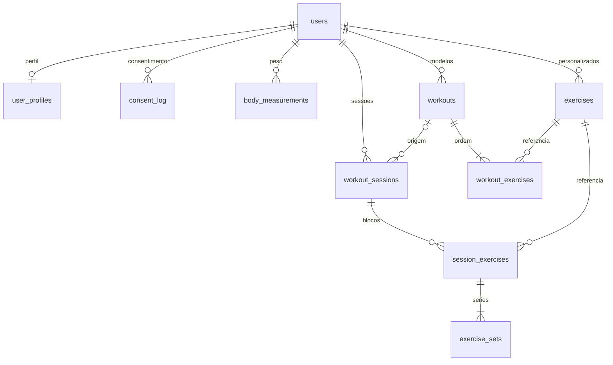

# Gym Easy

Gym Easy (V1). Next.js (App Router) + TypeScript estrito + Tailwind CSS v4 + Drizzle no Neon.

## Requisitos

- Node.js 22 ou mais recente
- pnpm 10 (`packageManager` do `package.json`)
- [gitleaks](https://github.com/gitleaks/gitleaks) v8.30.1 no `PATH` (hook de pre-commit)

## Setup local

```bash
pnpm install
cp .env.example .env.local
```

Preencha `DATABASE_URL` em `.env.local` com a connection string do Neon. Use o host **pooled** para o app e o host **direct** para migrações. A variável é só de servidor: não use o prefixo `NEXT_PUBLIC_`.

O email de autenticação sai pelo transporte em `EMAIL_TRANSPORT` (`resend` ou `smtp`). Em desenvolvimento o padrão é `smtp`; em produção o padrão é `resend`. O teste usa o adapter de log, que registra só o nome do evento, sem endereço, link ou corpo. O remetente padrão é `Gym Easy <onboarding@resend.dev>`. O app não cria conta no Resend. `EMAIL_CAPTURE_PATH` existe só para o e2e e é ignorado quando `VERCEL_ENV=production`. Com o capture ativo, as credenciais do transporte não são exigidas.

Para o desenvolvimento local, suba o Mailpit e deixe o app falar com ele:

```bash
docker compose up mailpit
```

A UI abre em `http://127.0.0.1:8025` e o SMTP em `127.0.0.1:1025`. O `docker-compose.yml` publica essas portas só em `127.0.0.1` e também as expõe na rede interna `gym-easy`. `.env.example` aponta `SMTP_HOST=127.0.0.1` e `SMTP_PORT=1025` para o `pnpm dev` no host. `docker compose --profile app up` sobe o app na mesma rede com `EMAIL_TRANSPORT=smtp` e `SMTP_HOST=mailpit` (precisa de `.env.local` com `DATABASE_URL` e `CONFIRM_EMAIL_SECRET`).

No Coolify, não crie um domínio público nem mapeie a UI do Mailpit em `0.0.0.0`. A interface não tem autenticação. O acesso fica só na tailnet ou na rede interna do Coolify.

Previews da Vercel não alcançam esse Mailpit: o runtime da Vercel só fala com um SMTP que esteja na internet. O padrão do preview continua sendo Resend (`NODE_ENV=production` e `VERCEL_ENV=preview`). Este repositório não configura a Vercel. SMTP em produção (`VERCEL_ENV=production`, ou `NODE_ENV=production` fora de um preview) só liga com `EMAIL_TRANSPORT=smtp` e `SMTP_ALLOW_PRODUCTION=true`. Sem esse opt-in o processo recusa subir, para não enviar email real por engano.

```bash
pnpm dev
```

O app abre em `http://127.0.0.1:3000`. `GET /api/health` executa `select 1` e responde `{ "status": "ok", "db": "ok" }`. Se o banco falhar, responde 503 `{ "status": "error", "db": "unavailable" }` sem detalhes do erro. O catálogo visual fica em `/design` e responde 404 quando `VERCEL_ENV=production`.

`pnpm build` não precisa de um Postgres real. Durante o build, se `DATABASE_URL` estiver ausente, `src/lib/env.ts` usa um placeholder que não abre conexão. Em `pnpm dev` e `pnpm start` a variável continua obrigatória para qualquer código que chame `getDb()`.

## Banco

O schema Drizzle mora em `src/db/schema.ts`. Na Vercel o cliente usa o driver HTTP serverless do Neon (`@neondatabase/serverless` + `drizzle-orm/neon-http`). Postgres local e a CI usam o protocolo wire (`pg`) quando `DATABASE_DRIVER=pg` ou quando o host é `localhost` / `127.0.0.1`.

```bash
pnpm db:generate   # gera SQL em src/db/migrations
pnpm db:migrate    # aplica no DATABASE_URL (host direct)
```

`pnpm db:migrate` aplica só o SQL pendente. Use o host direct do Neon, sem `-pooler`.

- No pull request, a CI sobe um Postgres 16 e migra só esse banco.
- Na branch Neon `dev`, aplique com o host direct dessa branch. A branch `main` do Neon é produção: não migre a partir de uma branch de feature.
- Em produção, `.github/workflows/migrate.yml` roda em todo push na `main` e executa `pnpm db:migrate`. O valor vem do secret `DATABASE_URL_UNPOOLED` do environment `production` no GitHub (Settings → Environments → production → Environment secrets). Use a connection string direct da branch Neon `main`. O job falha se o secret estiver vazio ou se o host tiver `-pooler`, e não imprime a URL. O deploy da Vercel na `main` pode começar em paralelo; o job é idempotente. Este repositório não aplica a migração de produção sozinho.

Não edite uma migração que já tenha sido aplicada.

## Modelo de dados

A V1 guarda credenciais, perfil, catálogo de exercícios, modelos de treino e o que foi executado. O `user_id` de cada linha vem da sessão. Nenhum schema Zod aceita `userId` no corpo da requisição. As queries de `src/features/training/repository.ts` filtram por esse id e respondem "não encontrado" quando o recurso é de outra pessoa.



| Tabela                                                               | Papel                                                                                                                                                                 |
| -------------------------------------------------------------------- | --------------------------------------------------------------------------------------------------------------------------------------------------------------------- |
| `users`, `sessions`, `email_verification_tokens`, `auth_rate_limits` | Conta e sessão (LED-6).                                                                                                                                               |
| `user_profiles`                                                      | Única tabela de perfil. Ano de nascimento, sexo, altura, objetivo, nível, dias, minutos, local, unidade, tema e descanso. Não existe `user_profile` nem coluna `age`. |
| `consent_log`                                                        | Consentimento append-only (`body_data`, `coach_health`, `analytics`). Revogação é uma linha nova. Depois da exclusão da conta fica só o pseudônimo HMAC.              |
| `body_measurements`                                                  | Histórico de peso. No máximo um registro por usuário e dia; o do mesmo dia substitui o anterior.                                                                      |
| `exercises`                                                          | Catálogo compartilhado (`owner_user_id` nulo) e exercícios criados pelo usuário.                                                                                      |
| `workouts`, `workout_exercises`                                      | Modelo de treino e a ordem dos exercícios, com metas de séries, repetições, carga e descanso.                                                                         |
| `workout_sessions`, `session_exercises`, `exercise_sets`             | Treino realizado. A sessão copia o nome do modelo. Cada série guarda carga, repetições e o instante em que foi concluída.                                             |

O perfil da V1 e o do coach (IA e Saúde) são a mesma linha em `user_profiles`. Idade não é coluna: o banco guarda `birth_year` (`smallint`, check `ano_atual − 100` até `ano_atual`) e a aplicação deriva a idade aproximada (`ano_atual − birth_year`) e a faixa `age_band` (`16–17`, `18–29`, `30–39`, `40–49`, `50–59`, `60–69`, `70+`). A idade mínima de 16 anos também fica só na aplicação: `isUnderMinimumAge` bloqueia quando `ano_atual − birth_year ≤ 16` (LED-46). Peso continua só em `body_measurements`. PAR-Q+, lesões e planos do coach ficam para tabelas próprias futuras e não copiam estes campos. `coach_consents` e `analytics_consent` não existem: o estado é a última linha de `consent_log` por finalidade.

Altura fica em centímetros (100–250). Massa fica sempre em quilogramas, com uma casa (`numeric`): peso corporal em `weight_kg`, carga em `load_kg` e `target_load_kg`. Libra só existe na borda da validação (1 kg = 2,20462 lb, faixas 30–300 kg e 66–660 lb). O check do banco em `weight_kg` é 29,0–301,0 para absorver o arredondamento dessa conversão.

Exercícios padrão não têm dono e não podem ser arquivados. O nome é único no catálogo e, para os personalizados, único por usuário depois de ignorar maiúsculas e acentos (`normalized_name`). Um personalizado com histórico ou presente num modelo é arquivado (`archived_at`); sem uso, é apagado. O catálogo vigente é o JSON oficial da LED-32 (`src/db/seed/exercises.v2.json`, versão `2026-10-14.v2`, 136 exercícios). Os ids em português são os slugs estáveis. Padrão de movimento, músculos, equipamento, nível e regiões usam enums em inglês; o nome exibido fica em `name_pt`. `muscle_group` continua sendo o grupo amplo do primeiro músculo primário, para o filtro da biblioteca. O seed idempotente por slug está em `0007_catalog_v2.sql` (`ON CONFLICT ("slug") DO NOTHING`). `0009_is_plyometric` acrescenta `is_plyometric` e atualiza o catálogo com `INSERT ... ON CONFLICT (slug) DO UPDATE`, sem apagar linhas. `body_region` é o mesmo enum que `injury.region` vai usar. `is_plyometric` é verdadeiro só em `agachamento_com_salto`.

Apagar um modelo não apaga sessões: `workout_sessions.workout_id` usa `ON DELETE SET NULL` e o nome já foi copiado na sessão. Filhos de treino e de sessão carregam o mesmo `user_id` do pai, amarrado por chave estrangeira composta. Há no máximo uma sessão `in_progress` por usuário.

Apagar a conta apaga em cascata o perfil, o peso, os treinos, as sessões, as séries, os exercícios criados por essa pessoa e as linhas de treino ou de sessão que os referenciam. O catálogo compartilhado fica. `consent_log` não sai com a conta: na mesma operação a prova ganha `subject_pseudonym` (HMAC-SHA256 da versão da chave e do id, com `CONSENT_PSEUDONYM_KEY`), `key_version` e `deleted_account_at`, e `user_id` fica nulo (`ON DELETE SET NULL`). Um `UPDATE` ou `DELETE` direto continua recusado. A prova pseudonimizada fica 3 anos, só para defesa legal, e o cron diário `/api/cron/purge-consent-proofs` apaga o que passou do prazo. O texto está em `/privacidade`.

Progressão de carga é calculada, não armazenada. Entram só séries com `completed_at` em sessões `completed`. Por sessão, a maior carga com pelo menos 1 repetição e o volume (`soma de carga × repetições`) saem em ordem de `finished_at`. A carga é recorde pessoal quando supera todas as sessões anteriores. Os índices de leitura são `(user_id, finished_at)` em `workout_sessions` e `(exercise_id)` em `session_exercises`.

Valores estáveis:

| Campo                    | Valores                                                                                                                                                                                                                                                                                          | Rótulos                                                                                                                                             |
| ------------------------ | ------------------------------------------------------------------------------------------------------------------------------------------------------------------------------------------------------------------------------------------------------------------------------------------------ | --------------------------------------------------------------------------------------------------------------------------------------------------- |
| `sex`                    | `male`, `female`, `undisclosed`                                                                                                                                                                                                                                                                  | Masculino, Feminino, Prefiro não dizer                                                                                                              |
| `goal`                   | `hypertrophy`, `strength`, `fat_loss`, `conditioning`, `health`                                                                                                                                                                                                                                  | Hipertrofia, Força, Emagrecimento, Condicionamento, Saúde                                                                                           |
| `training_place`         | `full_gym`, `dumbbells`, `home`, `bodyweight`                                                                                                                                                                                                                                                    | Academia completa, Halteres em casa, Casa sem equipamento, Peso corporal                                                                            |
| `consent_purpose`        | `body_data`, `coach_health`, `analytics`                                                                                                                                                                                                                                                         | Dados do corpo, Saúde do coach, Uso anônimo                                                                                                         |
| `consent_action`         | `granted`, `revoked`                                                                                                                                                                                                                                                                             | Concedido, Revogado                                                                                                                                 |
| `consent_source`         | `onboarding`, `profile`, `reconsent`                                                                                                                                                                                                                                                             | Onboarding, Perfil, Novo consentimento                                                                                                              |
| `training_level`         | `beginner`, `intermediate`, `advanced`                                                                                                                                                                                                                                                           | Iniciante, Intermediário, Avançado                                                                                                                  |
| `mass_unit`              | `kg`, `lb`                                                                                                                                                                                                                                                                                       | kg, lb. O banco continua em kg.                                                                                                                     |
| `theme`                  | `dark`, `light`, `system`                                                                                                                                                                                                                                                                        | Escuro, Claro, Sistema. Padrão `dark`.                                                                                                              |
| `muscle_group`           | `chest`, `back`, `shoulders`, `biceps`, `triceps`, `forearms`, `quadriceps`, `hamstrings`, `glutes`, `calves`, `abs`, `full_body`, `cardio`                                                                                                                                                      | Peito, Costas, Ombros, Bíceps, Tríceps, Antebraço, Quadríceps, Posterior, Glúteos, Panturrilha, Abdômen, Corpo inteiro, Cardio                      |
| `equipment`              | `barbell`, `dumbbell`, `machine`, `smith_machine`, `cable`, `bodyweight`, `resistance_band`, `kettlebell`, `accessory`                                                                                                                                                                           | Barra, Halteres, Máquina, Smith, Cabo, Peso corporal, Elástico, Kettlebell, Acessório                                                               |
| `movement_pattern`       | `squat`, `hip_hinge`, `lunge`, `horizontal_push`, `vertical_push`, `horizontal_pull`, `vertical_pull`, `core`, `isolation`, `carry`                                                                                                                                                              | Agachamento, Dobradiça de quadril, Avanço, Empurrar horizontal, Empurrar vertical, Puxar horizontal, Puxar vertical, Core, Isolamento, Carregamento |
| `muscle`                 | `chest`, `triceps`, `biceps`, `forearms`, `front_delts`, `side_delts`, `rear_delts`, `rotator_cuff`, `lats`, `rhomboids`, `mid_traps`, `upper_traps`, `spinal_erectors`, `abs`, `obliques`, `hip_flexors`, `glutes`, `glute_medius`, `adductors`, `quadriceps`, `hamstrings`, `calves`, `soleus` | Nomes em português em `MUSCLE_LABELS`                                                                                                               |
| `body_region`            | `shoulder`, `elbow`, `wrist`, `neck`, `lower_back`, `hip`, `knee`, `ankle`                                                                                                                                                                                                                       | Ombro, Cotovelo, Punho, Pescoço, Coluna lombar, Quadril, Joelho, Tornozelo. O mesmo enum vale para `injury.region`.                                 |
| `workout_session_status` | `in_progress`, `completed`                                                                                                                                                                                                                                                                       | Em andamento, Concluída                                                                                                                             |

Migrações desta etapa: `0001_training_model` (tabelas), `0002_seed_exercises` (catálogo inicial, substituído em seguida), `0003_birth_year_consent` (ano de nascimento, rotina do coach no mesmo perfil e `consent_log`), `0004_cascade_exercise_refs` (apagar a conta também apaga o exercício próprio e o histórico que o cita), `0005_catalog_exercises` (metadados do catálogo), `0006_seed_exercises` (primeira carga dos 136, com slugs em inglês), `0007_catalog_v2` (enums oficiais da LED-32 e slugs em português) `0008_consent_retention` (`UNIQUE (id, user_id)`, `ON DELETE SET NULL` e a prova pseudonimizada) e `0009_is_plyometric` (flag de salto e upsert do catálogo por slug). `0003` copia `extract(year from birth_date)` antes de apagar a data completa. Elas sobem na branch Neon `dev` e no Postgres da CI. A branch Neon `main` continua só com o que já foi aplicado em produção; o workflow de produção roda no push da `main`.

O projeto Neon deste app é `app-de-treino` (`blue-cell-40302441`), banco `app_treino`. A branch `dev` é `br-sweet-recipe-ba0pwnn3`. A branch `main` desse projeto é produção. Não aplique migrações no projeto `gymeasy`.

`saveProfile` e `recordWeight` só gravam com consentimento `body_data` ativo: o último evento desse tipo precisa ser `granted`. Sem linha, ou com o último evento `revoked`, a resposta é `consent_required` e nada é escrito. `consent_log` não tem UPDATE nem DELETE na aplicação. Um trigger recusa os dois, e só abre a exceção dentro de `delete_account` e `purge_expired_consent_proofs`. `REVOKE UPDATE, DELETE` em `PUBLIC` cobre papéis que não são donos da tabela. A chave do HMAC não entra no banco.

## Autenticação

Cadastro, confirmação de email, login e logout ficam em `/cadastro`, `/cadastro/confirme`, `/cadastro/confirmar` e `/login`. A senha usa argon2id. A sessão é um cookie `ge_session` (`HttpOnly`, `Secure` em HTTPS, `SameSite=Lax`) cujo valor no banco é só o hash. Rotas do app (`/inicio`, `/onboarding`, `/treinos`, `/historico`, `/perfil`) exigem sessão. O cadastro sempre responde "Se o email for válido, enviamos um link para continuar." Conta nova recebe um link de confirmação; email já usado avisa o dono. Com transporte `log`, esses envios só entram no log, sem endereço nem segredo.

## Qualidade

```bash
pnpm lint
pnpm typecheck
pnpm test
pnpm test:e2e
pnpm build
```

Commits seguem Conventional Commits (`feat:`, `fix:`, `chore:`, `refactor:`, `test:`, `docs:`). O pre-commit roda lint-staged e gitleaks; o commit-msg roda commitlint.

## Variáveis de ambiente

| Variável                | Onde           | Notas                                                                                                                                                                                   |
| ----------------------- | -------------- | --------------------------------------------------------------------------------------------------------------------------------------------------------------------------------------- |
| `DATABASE_URL`          | Servidor       | Postgres do Neon, host pooled. Obrigatória em runtime. Ausente no build (`NEXT_PHASE=phase-production-build`) é aceito e não abre conexão.                                              |
| `CONSENT_PSEUDONYM_KEY` | Servidor       | Chave do HMAC da prova de consentimento. Mínimo de 32 caracteres. Obrigatória em runtime. No build, se estiver ausente, entra um placeholder que não é segredo. Não use `NEXT_PUBLIC_`. |
| `CRON_SECRET`           | Servidor       | Segredo do cron diário que apaga provas com mais de 3 anos. A Vercel envia `Authorization: Bearer`. Sem ele, a rota responde 401.                                                       |
| `EMAIL_TRANSPORT`       | Servidor       | `resend` ou `smtp`. Padrão: `smtp` em development, `resend` em production, `log` em test.                                                                                               |
| `RESEND_API_KEY`        | Servidor       | Obrigatória quando o transporte é `resend`. Sem transporte utilizável, o log não leva dados sensíveis.                                                                                  |
| `EMAIL_FROM`            | Servidor       | Opcional. Padrão `Gym Easy <onboarding@resend.dev>`.                                                                                                                                    |
| `SMTP_HOST`             | Servidor       | Obrigatório quando o transporte é `smtp`. No host local, `127.0.0.1`. Na rede do compose, `mailpit`.                                                                                    |
| `SMTP_PORT`             | Servidor       | Obrigatório quando o transporte é `smtp`. Mailpit usa `1025`.                                                                                                                           |
| `SMTP_USER`             | Servidor       | Opcional. Sem usuário, o cliente SMTP não envia `AUTH`.                                                                                                                                 |
| `SMTP_PASS`             | Servidor       | Opcional. Segredo. Não use o prefixo `NEXT_PUBLIC_`.                                                                                                                                    |
| `SMTP_SECURE`           | Servidor       | Opcional. `true`, `false`, `1` ou `0`. Padrão `false` (Mailpit em 1025). `true` abre TLS direto, como na porta 465.                                                                     |
| `SMTP_ALLOW_PRODUCTION` | Servidor       | Tem de ser `true` para usar `smtp` em produção. Preview da Vercel não usa este opt-in, mas só alcança SMTP público.                                                                     |
| `DATABASE_URL_UNPOOLED` | GitHub Actions | Secret do environment `production`. Host direct da branch Neon `main`. Não entra no app.                                                                                                |

Na Vercel, Preview usa a branch `dev` do projeto `app-de-treino` e Production usa a branch `main` do mesmo projeto. As funções rodam em `fra1` (`vercel.json`). Crie `CONSENT_PSEUDONYM_KEY` em Preview e Production, e `CRON_SECRET` em Production, antes do runtime. Não crie `NEXT_PUBLIC_DATABASE_URL` nem `NEXT_PUBLIC_CONSENT_PSEUDONYM_KEY`.

## CORS

A CDN da Vercel acrescenta `Access-Control-Allow-Origin: *` em HTML prerenderizado e arquivos estáticos, depois do proxy. O proxy apaga o header, mas a plataforma o recoloca nesses recursos. `vercel.json` substitui o `*` por `https://gym-easy.vercel.app`. Rotas `/api` não recebem o `*` da plataforma e ficam fora dessa regra.

## CI

O workflow `.github/workflows/ci.yml` sobe um Postgres 16 e um Mailpit `v1.31.5` (digest pinado), aplica `pnpm db:migrate` no Postgres e roda, em todo pull request: gitleaks (histórico completo e checksum do binário), lint, Prettier, typecheck, Vitest (com um teste de integração SMTP contra o Mailpit), build, Playwright, `pnpm audit --audit-level high` e `pnpm audit --prod`. A única exceção de audit é `CVE-2026-93687` (`braces`, dependência de desenvolvimento do ESLint, sem patch), registrada em `pnpm-workspace.yaml` com dono `leduardo99` e expiração em 2026-11-13. Dependabot abre atualizações semanais de npm e GitHub Actions.
