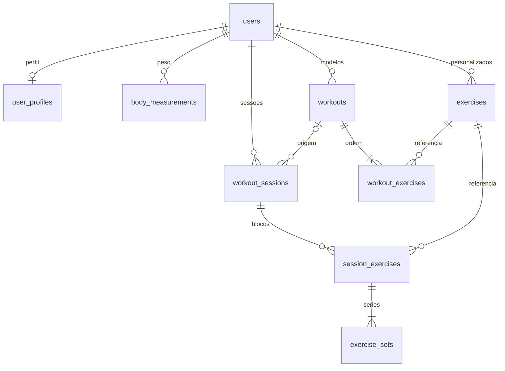

# Gym Easy

Gym Easy (V1). Next.js (App Router) + TypeScript estrito + Tailwind CSS v4 + Drizzle no Neon.

## Requisitos

- Node.js 22 ou mais recente
- pnpm 10 (`packageManager` do `package.json`)
- [gitleaks](https://github.com/gitleaks/gitleaks) v8.30.1 no `PATH` (hook de pre-commit)

## Setup local

```bash
pnpm install
cp .env.example .env.local
```

Preencha `DATABASE_URL` em `.env.local` com a connection string do Neon. Use o host **pooled** para o app e o host **direct** para migrações. A variável é só de servidor: não use o prefixo `NEXT_PUBLIC_`.

`RESEND_API_KEY` e `EMAIL_FROM` também são só de servidor e opcionais. Sem a chave, o app usa o adapter de log (sem email, link ou corpo da mensagem). O remetente padrão é `Gym Easy <onboarding@resend.dev>`. O app não cria conta no Resend. `EMAIL_CAPTURE_PATH` existe só para o e2e local e é ignorado quando `VERCEL_ENV=production`.

```bash
pnpm dev
```

O app abre em `http://127.0.0.1:3000`. `GET /api/health` executa `select 1` e responde `{ "status": "ok", "db": "ok" }`. Se o banco falhar, responde 503 `{ "status": "error", "db": "unavailable" }` sem detalhes do erro. O catálogo visual fica em `/design` e responde 404 quando `VERCEL_ENV=production`.

`pnpm build` não precisa de um Postgres real. Durante o build, se `DATABASE_URL` estiver ausente, `src/lib/env.ts` usa um placeholder que não abre conexão. Em `pnpm dev` e `pnpm start` a variável continua obrigatória para qualquer código que chame `getDb()`.

## Banco

O schema Drizzle mora em `src/db/schema.ts`. Na Vercel o cliente usa o driver HTTP serverless do Neon (`@neondatabase/serverless` + `drizzle-orm/neon-http`). Postgres local e a CI usam o protocolo wire (`pg`) quando `DATABASE_DRIVER=pg` ou quando o host é `localhost` / `127.0.0.1`.

```bash
pnpm db:generate   # gera SQL em src/db/migrations
pnpm db:migrate    # aplica no DATABASE_URL (host direct)
```

`pnpm db:migrate` aplica só o SQL pendente. Use o host direct do Neon, sem `-pooler`.

- No pull request, a CI sobe um Postgres 16 e migra só esse banco.
- Na branch Neon `dev`, aplique com o host direct dessa branch. A branch `main` do Neon é produção: não migre a partir de uma branch de feature.
- Em produção, `.github/workflows/migrate.yml` roda em todo push na `main` e executa `pnpm db:migrate`. O valor vem do secret `DATABASE_URL_UNPOOLED` do environment `production` no GitHub (Settings → Environments → production → Environment secrets). Use a connection string direct da branch Neon `main`. O job falha se o secret estiver vazio ou se o host tiver `-pooler`, e não imprime a URL. O deploy da Vercel na `main` pode começar em paralelo; o job é idempotente. Este repositório não aplica a migração de produção sozinho.

Não edite uma migração que já tenha sido aplicada.

## Modelo de dados

A V1 guarda credenciais, perfil, catálogo de exercícios, modelos de treino e o que foi executado. O `user_id` de cada linha vem da sessão. Nenhum schema Zod aceita `userId` no corpo da requisição. As queries de `src/features/training/repository.ts` filtram por esse id e respondem "não encontrado" quando o recurso é de outra pessoa.



| Tabela                                                               | Papel                                                                                                                     |
| -------------------------------------------------------------------- | ------------------------------------------------------------------------------------------------------------------------- |
| `users`, `sessions`, `email_verification_tokens`, `auth_rate_limits` | Conta e sessão (LED-6).                                                                                                   |
| `user_profiles`                                                      | Um perfil por usuário: nascimento, sexo, altura, objetivo, nível, unidade, tema e descanso padrão.                        |
| `body_measurements`                                                  | Histórico de peso. No máximo um registro por usuário e dia; o do mesmo dia substitui o anterior.                          |
| `exercises`                                                          | Catálogo compartilhado (`owner_user_id` nulo) e exercícios criados pelo usuário.                                          |
| `workouts`, `workout_exercises`                                      | Modelo de treino e a ordem dos exercícios, com metas de séries, repetições, carga e descanso.                             |
| `workout_sessions`, `session_exercises`, `exercise_sets`             | Treino realizado. A sessão copia o nome do modelo. Cada série guarda carga, repetições e o instante em que foi concluída. |

Idade não é coluna: ela é calculada a partir de `birth_date` (13–100 anos). Altura fica em centímetros (100–250). Massa fica sempre em quilogramas, com uma casa (`numeric`): peso corporal em `weight_kg`, carga em `load_kg` e `target_load_kg`. Libra só existe na borda da validação (1 kg = 2,20462 lb, faixas 30–300 kg e 66–660 lb). O check do banco em `weight_kg` é 29,0–301,0 para absorver o arredondamento dessa conversão.

Exercícios padrão não têm dono e não podem ser arquivados. O nome é único no catálogo e, para os personalizados, único por usuário depois de ignorar maiúsculas e acentos (`normalized_name`). Um personalizado com histórico ou presente num modelo é arquivado (`archived_at`); sem uso, é apagado. O seed idempotente está em `0002_seed_exercises.sql` (84 exercícios, `ON CONFLICT DO NOTHING`).

Apagar um modelo não apaga sessões: `workout_sessions.workout_id` usa `ON DELETE SET NULL` e o nome já foi copiado na sessão. Filhos de treino e de sessão carregam o mesmo `user_id` do pai, amarrado por chave estrangeira composta. Há no máximo uma sessão `in_progress` por usuário.

Progressão de carga é calculada, não armazenada. Entram só séries com `completed_at` em sessões `completed`. Por sessão, a maior carga com pelo menos 1 repetição e o volume (`soma de carga × repetições`) saem em ordem de `finished_at`. A carga é recorde pessoal quando supera todas as sessões anteriores. Os índices de leitura são `(user_id, finished_at)` em `workout_sessions` e `(exercise_id)` em `session_exercises`.

Valores estáveis:

| Campo                    | Valores                                                                                                                                     | Rótulos                                                                                                                        |
| ------------------------ | ------------------------------------------------------------------------------------------------------------------------------------------- | ------------------------------------------------------------------------------------------------------------------------------ |
| `sex`                    | `male`, `female`, `undisclosed`                                                                                                             | Masculino, Feminino, Prefiro não dizer                                                                                         |
| `goal`                   | `hypertrophy`, `strength`, `fat_loss`, `conditioning`                                                                                       | Hipertrofia, Força, Emagrecimento, Condicionamento                                                                             |
| `training_level`         | `beginner`, `intermediate`, `advanced`                                                                                                      | Iniciante, Intermediário, Avançado                                                                                             |
| `mass_unit`              | `kg`, `lb`                                                                                                                                  | kg, lb. O banco continua em kg.                                                                                                |
| `theme`                  | `dark`, `light`, `system`                                                                                                                   | Escuro, Claro, Sistema. Padrão `dark`.                                                                                         |
| `muscle_group`           | `chest`, `back`, `shoulders`, `biceps`, `triceps`, `forearms`, `quadriceps`, `hamstrings`, `glutes`, `calves`, `abs`, `full_body`, `cardio` | Peito, Costas, Ombros, Bíceps, Tríceps, Antebraço, Quadríceps, Posterior, Glúteos, Panturrilha, Abdômen, Corpo inteiro, Cardio |
| `equipment`              | `barbell`, `dumbbell`, `machine`, `cable`, `bodyweight`, `kettlebell`, `band`, `other`                                                      | Barra, Halteres, Máquina, Cabo, Peso corporal, Kettlebell, Elástico, Outro                                                     |
| `workout_session_status` | `in_progress`, `completed`                                                                                                                  | Em andamento, Concluída                                                                                                        |

Migrações desta etapa: `0001_training_model` (tabelas) e `0002_seed_exercises` (catálogo). Elas sobem na branch Neon `dev` e no Postgres da CI. A branch Neon `main` continua só com o que já foi aplicado em produção; o workflow de produção roda no push da `main`.

## Autenticação

Cadastro, confirmação de email, login e logout ficam em `/cadastro`, `/cadastro/confirme`, `/cadastro/confirmar` e `/login`. A senha usa argon2id. A sessão é um cookie `ge_session` (`HttpOnly`, `Secure` em HTTPS, `SameSite=Lax`) cujo valor no banco é só o hash. Rotas do app (`/inicio`, `/onboarding`, `/treinos`, `/historico`, `/perfil`) exigem sessão. O cadastro sempre responde "Se o email for válido, enviamos um link para continuar." Conta nova recebe um link de confirmação; email já usado avisa o dono. Sem `RESEND_API_KEY`, esses envios só entram no log.

## Qualidade

```bash
pnpm lint
pnpm typecheck
pnpm test
pnpm test:e2e
pnpm build
```

Commits seguem Conventional Commits (`feat:`, `fix:`, `chore:`, `refactor:`, `test:`, `docs:`). O pre-commit roda lint-staged e gitleaks; o commit-msg roda commitlint.

## Variáveis de ambiente

| Variável                | Onde           | Notas                                                                                                                                      |
| ----------------------- | -------------- | ------------------------------------------------------------------------------------------------------------------------------------------ |
| `DATABASE_URL`          | Servidor       | Postgres do Neon, host pooled. Obrigatória em runtime. Ausente no build (`NEXT_PHASE=phase-production-build`) é aceito e não abre conexão. |
| `RESEND_API_KEY`        | Servidor       | Opcional. Sem ela, os emails de auth vão para o log, sem dados sensíveis.                                                                  |
| `EMAIL_FROM`            | Servidor       | Opcional. Padrão `Gym Easy <onboarding@resend.dev>`.                                                                                       |
| `DATABASE_URL_UNPOOLED` | GitHub Actions | Secret do environment `production`. Host direct da branch Neon `main`. Não entra no app.                                                   |

Na Vercel, Preview usa a branch `dev` do Neon e Production usa a branch `main`. As funções rodam em `fra1` (`vercel.json`). Não crie `NEXT_PUBLIC_DATABASE_URL`.

## CORS

A CDN da Vercel acrescenta `Access-Control-Allow-Origin: *` em HTML prerenderizado e arquivos estáticos, depois do proxy. O proxy apaga o header, mas a plataforma o recoloca nesses recursos. `vercel.json` substitui o `*` por `https://gym-easy.vercel.app`. Rotas `/api` não recebem o `*` da plataforma e ficam fora dessa regra.

## CI

O workflow `.github/workflows/ci.yml` sobe um Postgres 16, aplica `pnpm db:migrate` nele e roda, em todo pull request: gitleaks (histórico completo e checksum do binário), lint, Prettier, typecheck, Vitest, build, Playwright, `pnpm audit --audit-level high` e `pnpm audit --prod`. A única exceção de audit é `CVE-2026-93687` (`braces`, dependência de desenvolvimento do ESLint, sem patch), registrada em `pnpm-workspace.yaml` com dono `leduardo99` e expiração em 2026-11-13. Dependabot abre atualizações semanais de npm e GitHub Actions.
